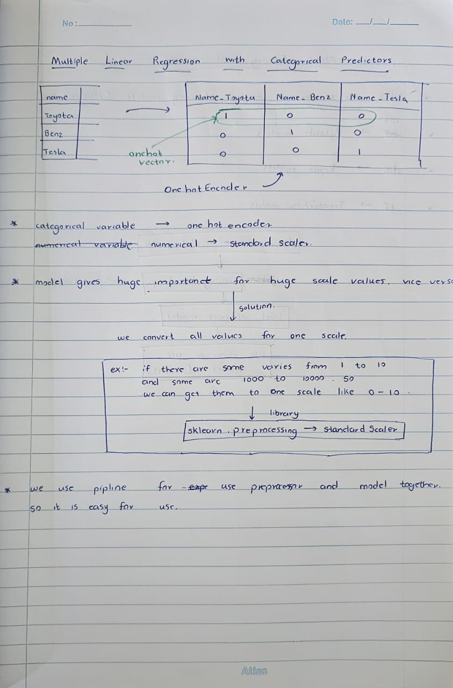
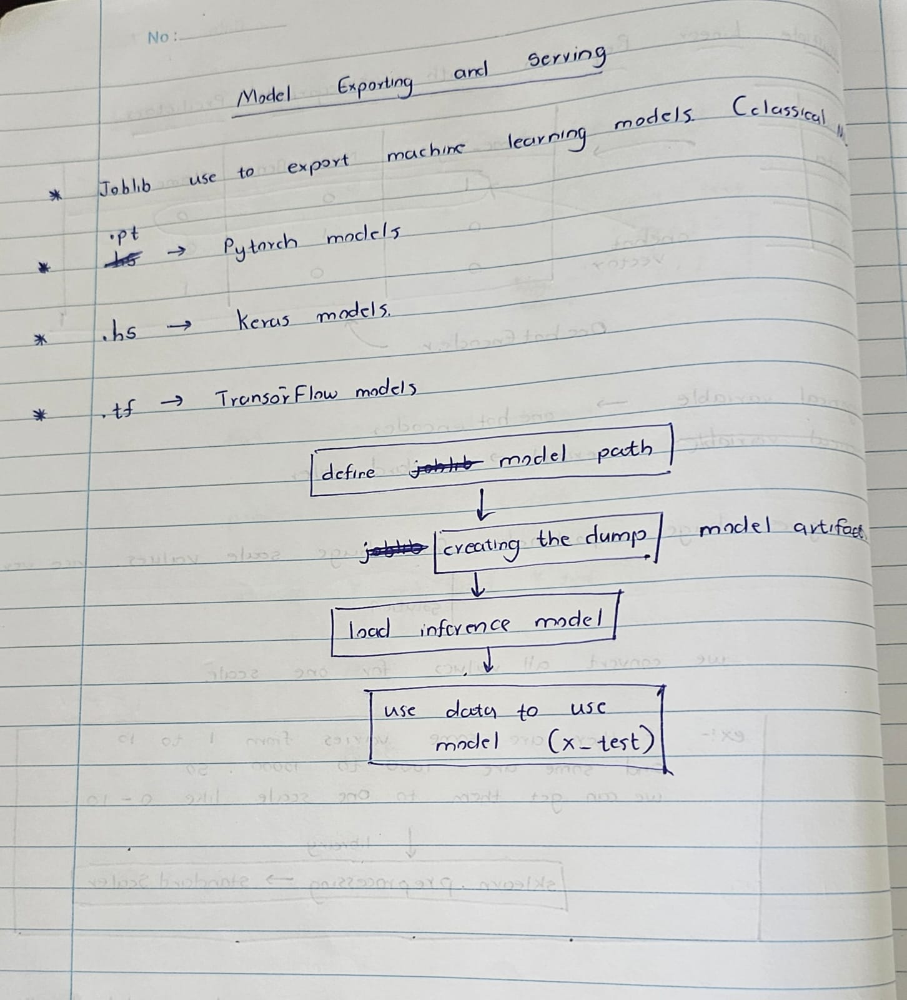

# Week 04 - Multiple Linear Regression, Preprocessing & Model Serving

## Key concepts

- Categorical Variable Representation
  - Regression algorithms require numeric inputs and cannot parse text labels directly.
  - One-hot encoding converts discrete categories into binary presence indicators, expanding categorical fields into dedicated indicator columns without imposing an artificial order.

- Feature Scaling and Scale Sensitivity
  - Predictors measured across large numerical ranges dominate gradient updates and unregularized coefficient weights relative to features with smaller spans.
  - Standardizing features transforms each column to a common scale, ensuring relative weight reflects signal rather than arbitrary unit magnitude.

- Pipeline Modularization
  - Bundling data transformations and estimators into an integrated workflow prevents data leakage across cross-validation splits.
  - An atomic pipeline structure guarantees that transformations executed during training apply identically during inference.

- Model Serialization and Artifact Serving
  - Model training and production serving are decoupled processes.
  - Exporting serialized artifacts preserves learned parameters and preprocessing states for runtime inference without re-executing training logic.

## What I learnt

- Multiple Linear Regression with Categorical Predictors
  - Raw categorical labels (like car brands: Toyota, Benz, Tesla) must be converted into numerical format before feeding them into regression models.
  - One-Hot Encoder maps each category into separate binary columns (one-hot vector) containing 0s and 1s to show which class is active.

- Feature Scaling with StandardScaler
  - Regression models assign heavy importance to variables with large numerical values compared to smaller ones.
  - When features have mismatched ranges (such as 1 to 10 versus 1,000 to 10,000), standard scaling converts all values onto a single balanced scale.
  - Scikit-learn's `StandardScaler` from `sklearn.preprocessing` handles this numeric normalization.

- Combining Preprocessing and Estimators Using Pipelines
  - Using a pipeline binds the preprocessor and the regression model together into a clean, single workflow.
  - This structure avoids manual transformation errors and makes running inference much easier.

- Model Exporting Formats Across Frameworks
  - Classical machine learning models are commonly exported using `joblib`.
  - PyTorch models use the `.pt` extension.
  - Keras models use `.h5`.
  - TensorFlow models use `.tf`.

- Inference and Serving Workflow
  - Define the target file path for the model artifact.
  - Create the serialized dump file on disk.
  - Load the exported inference model artifact back into memory.
  - Feed new test or production data (such as `x_test`) directly into the loaded model to generate predictions.

## Practical / code

- Notebook ---> `multiple_linear_regression_serving.ipynb`

  Contains the complete workflow for encoding categorical features, scaling numeric data, fitting the model, and exporting artifacts.

- Data Preprocessing
  - Transformed categorical features using `OneHotEncoder` from `sklearn.preprocessing`.
  - Standardized continuous numerical variables using `StandardScaler` from `sklearn.preprocessing`.
  - Assembled the preprocessing steps and the regression estimator into an end-to-end `Pipeline`.

- Model Training & Evaluation
  - Split the dataset into training and testing partitions using a consistent random state.
  - Fitted the multiple linear regression model through the combined pipeline.
  - Evaluated baseline test performance using RMSE, MAE, and R-squared.

- Model Serialization & Serving
  - Serialized the fitted pipeline using `joblib.dump()` to create a reusable artifact.
  - Reloaded the model using `joblib.load()` to confirm inference readiness.
  - Generated test predictions directly from the reloaded model artifact.

## Assignment / homework

### Task 1: Handling Mixed Feature Types
- Applied one-hot encoding to all categorical variables to avoid implying an artificial ordinal ranking.
- Scaled numeric variables so differences in raw scales do not skew coefficient learning.

### Task 2: Building the End-to-End Pipeline
- Connected categorical encoders, feature scalers, and the regression model into a single pipeline object.
- Verified that transformations apply consistently across both training and test sets without manual intervention.

### Task 3: Exporting and Verifying the Model Artifact
- Exported the fitted pipeline to disk using Joblib.
- Loaded the artifact back into memory and confirmed that predictions on the test set match the trained pipeline outputs.

## Questions / things to revisit

- How to account for the dummy variable trap when applying one-hot encoding without regularization.
- Deploying saved model artifacts behind a lightweight API framework like FastAPI or Flask for inference requests.